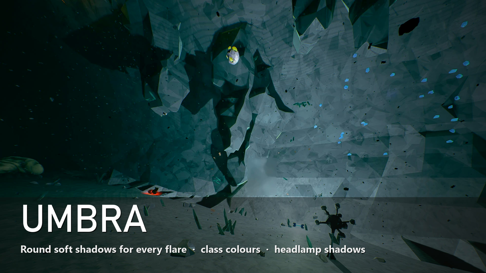
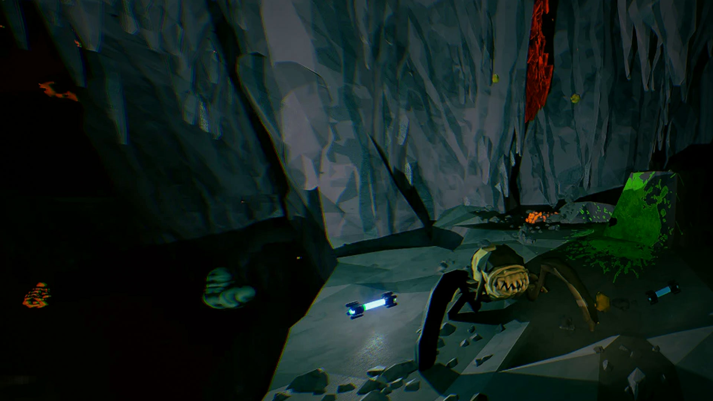
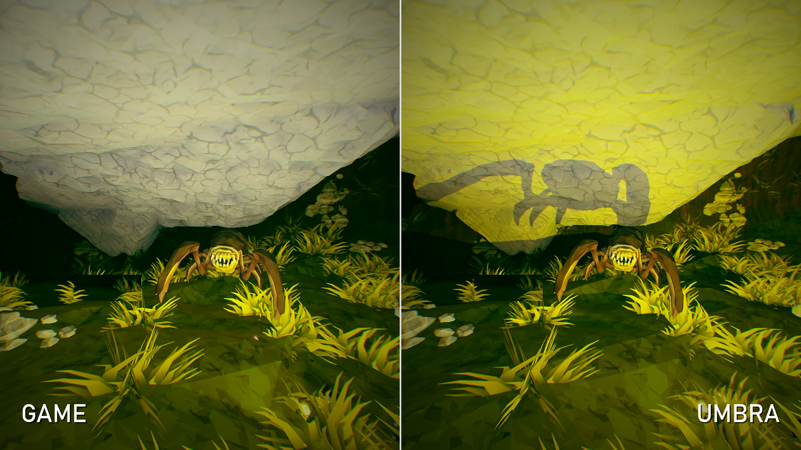
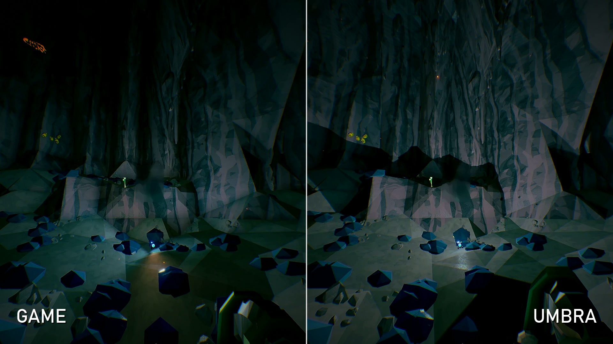
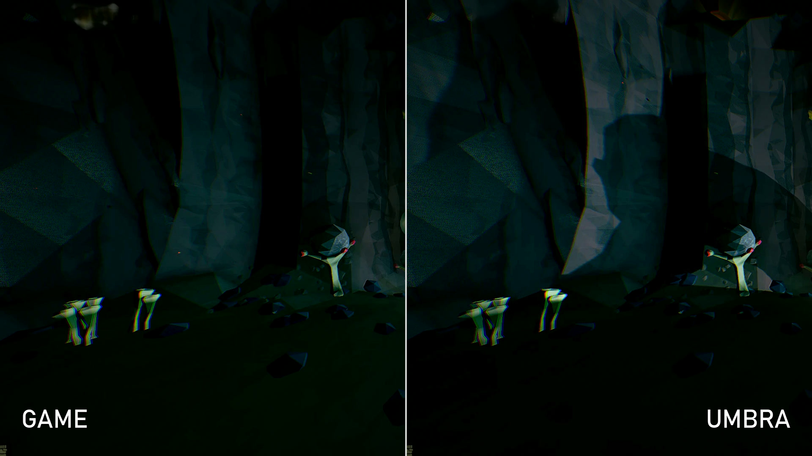

# Umbra Shadows

[](https://github.com/byrodi/umbra-shadows-drg/releases/latest)
[](LICENSE)

Deep Rock Galactic mod: every flare casts round, soft shadows in its class colour, and headlamps cast shadows too.



## Features

- Every flare lights all round and casts shadows of rocks, walls and bugs.
- Hand flares glow in the thrower's class colour.
- The flare gun keeps its own light and casts the same shadows.
- A flare that burns out fades away over a few seconds instead of switching off.
- Your headlamp and your team mates' headlamps cast shadows.
- Far shadows fade out smoothly, so a cave full of flares stays playable.
- Client-side only: other players in the lobby do not need it.



## Before and after

The same spot with the mod off and on.







## Installation

1. Download `umbra-shadows.pak` from the [latest release](https://github.com/byrodi/umbra-shadows-drg/releases/latest).
2. Add it to [mint](https://github.com/trumank/mint) as a local mod and install the profile.
3. Start the game. With [Mod Hub](https://mod.io/g/drg/m/mod-hub) installed, the settings are on the "Umbra Shadows" page.

Do not use it together with [Shadows!](https://mod.io/g/drg/m/shadows): that mod replaces the flares Umbra Shadows works on.

## Settings

All settings apply at once in a mission. Without Mod Hub the mod runs on Medium.

| Setting | Default | What it does |
| --- | --- | --- |
| Enabled | on | Off gives the lights back to the game. |
| Shadow quality | Medium | Low gives the most FPS. See the table below. |
| Class colour | 1 | 0 keeps the game's colours, 1 is the full class colour, up to 2 is brighter. |

| | Low | Medium | High | Ultra |
| --- | --- | --- | --- | --- |
| Hand flares with shadows (nearest) | 2 | 4 | 6 | all |
| Flare gun flares with shadows (nearest) | 0 | 1 | 2 | 4 |
| Flare shadows fade out beyond | 15 m | 20 m | 25 m | 40 m |
| Team headlamp shadows, soft edges | off | on | on | on |
| Shadows in fog | off | off | off | on |

Flares without a shadow still light the cave the same way. Your own headlamp and cave walls cast shadows on every level.

## Performance

Tested on Ryzen 9 7900X, RTX 5070, 32 GB RAM, 3840×2160 with DLSS Quality.
Frame rates read from the in-game FPS counter.

| Scene | Mod off (avg) | Mod on (avg / low) |
| --- | --- | --- |
| Normal play in a cave | 210 | 185 / 152 |
| Large crystal cave lit by flare gun flares | 178 | 155 / 133 |
| 50 bugs around flares | 144 | 125 / 115 |

## Compatibility

- Made to run next to [Advanced Darkness](https://mod.io/g/drg/m/advanced-darkness-reloaded), [Pretty Flashlights](https://mod.io/g/drg/m/pretty-flashlights), [Better Post Processing](https://mod.io/g/drg/m/better-post-processing-reloaded) and Mod Hub.
- Turns cave wall shadows back on, which Mod Hub hides by default.
- In a lobby, each player sees the shadows only when they run the mod themselves.

## How it works

The mod changes the game's own flare and headlamp lights; it adds no lights of its own.

1. A flare's fill light becomes one shadow light that reaches all round.
2. The flare's three spot lights stop casting shadows and only lift the darkness.
3. The engine's own shadow fade turns off the shadows of far flares.
4. In the last seconds of a flare, the mod dims its lights to zero itself. This is the only per-frame code, and it
   runs only while a flare is fading.

## Building from source

The mod is built with drg-toolkit, the author's own workspace for DRG mods (Unreal Engine 4.27, Python 3.11 or
newer, the BPForge editor plugin that writes Blueprints from a spec, and the `drg` command). It is not published
on its own. This repository sits in its `mods/` folder and has the mod's manifest `drgmod.toml`
(name, version, pak name, test).

```
drg build umbra            compile check, writes nothing
drg build umbra --save     regenerate Content/_Umbra from Tools/umbra_spec.py
drg test umbra             headless world test (Tools/umbra_test.py), checks the expected values
drg pack umbra             cook and pack umbra-shadows.pak
drg install umbra          put the pak into the active mint profile
drg release umbra          zip the pak to Release/umbra-shadows-<version>.zip
```

The Blueprints live as code in `Tools/umbra_spec.py`; edit them there, not in the editor.

## Credits

The idea of shadow-casting flares comes from [Shadows!](https://mod.io/g/drg/m/shadows) by zombieseatflesh7.

## License

[MIT](LICENSE)
